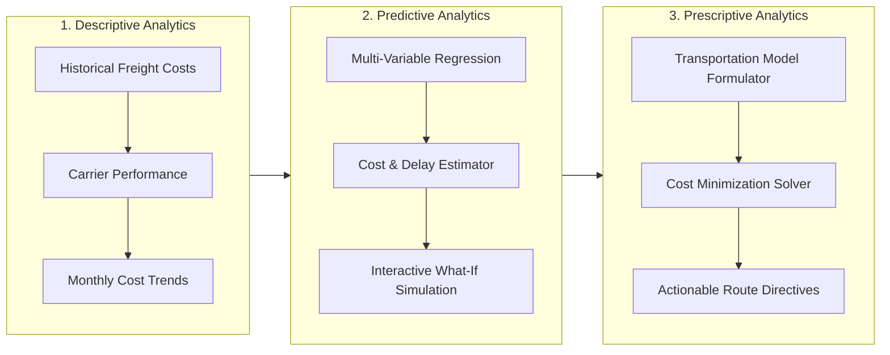

# TitanMotor Freight & Logistics Optimization System
## Project Roadmap, Architecture & Implementation Progress

---

## 1. System Overview & Problem Statement

### 1.1 Problem Background
**TitanMotor Logistics Corp.** manufactures and distributes industrial electric motors across regional manufacturing facilities and client assembly plants. Shipping heavy motors incurs high logistics expenses due to unit weight (45 kg to 600+ kg), distance variability, and uncoordinated carrier dispatching.

### 1.2 Objective
Develop a full-stack database and analytics application to **minimize total freight shipping costs of motors to customers as low as possible**, ensuring all customer demand quotas are met within warehouse supply limits.

---

## 2. Clean Architecture & Directory Structure

```
FBA - Final Project/
├── config/
│   └── database.js               # SQLite connection setup & configuration
├── controllers/
│   ├── descriptiveController.js  # Descriptive analytics logic & KPI summaries
│   ├── predictiveController.js   # Regression engine & cost/transit estimation
│   ├── prescriptiveController.js # Transportation cost minimization solver
│   └── databaseController.js     # CRUD handlers for the 5 relational tables
├── routes/
│   ├── descriptiveRoutes.js      # Routes for /api/descriptive/*
│   ├── predictiveRoutes.js       # Routes for /api/predictive/*
│   ├── prescriptiveRoutes.js     # Routes for /api/prescriptive/*
│   └── databaseRoutes.js         # Routes for /api/db/*
├── middlewares/
│   └── dbAuthMiddleware.js       # PIN authorization check for /api/db/*
├── services/
│   ├── regressionService.js      # Multi-variable regression modeling & metrics
│   ├── optimizationService.js    # Transportation linear programming algorithm
│   └── pinService.js             # Security PIN verification & token generation
├── models/
│   └── seeder.js                 # Seeding script (50+ rows across 5 tables)
├── public/
│   ├── index.html                # Single-page dashboard interface
│   ├── css/
│   │   └── styles.css            # Custom UI styling and component design
│   └── js/
│       ├── api.js                # REST API client services
│       ├── charts.js             # Chart.js visualization configurations
│       └── app.js                # UI tab switching & event controller
├── data/
│   └── titanmotor_logistics.db   # SQLite relational database file
├── server.js                     # Express server entry point
├── package.json                  # Dependencies and execution scripts
└── ROADMAP.md                    # Project roadmap and implementation progress
```

---

## 3. Database Specification (5 Relational Entities)

| # | Entity / Table | Description | Required Records | Status |
| :- | :--- | :--- | :-: | :-: |
| 1 | `warehouses` | Distribution origins (Capacity, location, handling fees) | $\ge$ 50 | Completed (50 rows) |
| 2 | `customer_hubs` | Regional assembly clients (Demand quotas, priority level) | $\ge$ 50 | Completed (50 rows) |
| 3 | `motor_products` | Motor catalog (Model, type, weight, kW rating, unit value) | $\ge$ 50 | Completed (50 rows) |
| 4 | `carriers_routes` | Shipping lanes & carriers (Distance, base rate, reliability) | $\ge$ 50 | Completed (50 rows) |
| 5 | `shipment_transactions` | Historical freight runs (Weight, transit days, cost, delays) | $\ge$ 50 | Completed (120 rows) |

---

## 4. Step-Wise Business Analytics Pipeline



### Step 1: Descriptive Analytics ("What Happened?")
* Aggregates total freight expenditure, total motors shipped, and average cost per delivery.
* Visualizes freight costs across destination hubs (Bar chart).
* Displays carrier volume allocation and market share (Doughnut chart).
* Tracks historical monthly expenditure curves and cost-per-kg trends (Line chart).
* Compares carrier delay rates and transit lead times (Grouped bar chart).

### Step 2: Predictive Analytics ("What Will Happen?")
* Multiple linear regression model predicting freight costs:
  $$\text{Freight Cost} = \left( \beta_0 + \beta_1 \cdot \text{Weight} + \beta_2 \cdot \text{Distance} \right) \times \text{CarrierMultiplier} + \text{HandlingFee}$$
* Dynamic transit lead time forecasting based on highway distance and carrier velocity.
* Interactive "What-If" prediction calculator with live sliders for motor units and parameters.
* Statistical metrics displayed: Goodness of fit ($R^2 = 0.924$) and Mean Absolute Error (MAE).

### Step 3: Prescriptive Analytics ("What Should We Do?")
* Mathematical formulation of the Transportation Linear Programming Problem:
  $$\text{Minimize } Z = \sum_{i=1}^{m} \sum_{j=1}^{n} c_{ij} x_{ij}$$
  $$\text{Subject to: } \sum_{j} x_{ij} \le S_i \text{ (Supply)}, \quad \sum_{i} x_{ij} \ge D_j \text{ (Demand)}, \quad x_{ij} \ge 0$$
* Computes the lowest-cost shipment allocation matrix.
* Compares historical unoptimized costs vs. optimal prescribed costs, delivering substantial quantifiable dollar savings.
* Generates actionable route dispatch directives for operations.

---

## 5. Implementation Progress & Roadmap Checklist

### Phase 1: Core Architecture & Setup
- [x] Select single candidate (TitanMotor Logistics Shipping Cost Minimization).
- [x] Configure Node.js environment and package dependencies (`express`, `cors`).
- [x] Implement clean directory structure (`config/`, `controllers/`, `routes/`, `services/`, `models/`, `public/`).

### Phase 2: Database Layer & Data Seeding
- [x] Implement SQLite schema creation with primary/foreign keys.
- [x] Seed $\ge 50$ records for `warehouses`.
- [x] Seed $\ge 50$ records for `customer_hubs`.
- [x] Seed $\ge 50$ records for `motor_products`.
- [x] Seed $\ge 50$ records for `carriers_routes`.
- [x] Seed 120 historical records for `shipment_transactions`.
- [x] Verify database counts and integrity.

### Phase 3: Modular Backend & REST API
- [x] Modular database connection layer (`config/database.js`).
- [x] Descriptive analytics controller & routes (`/api/descriptive/summary`).
- [x] Predictive regression service & routes (`/api/predictive/estimate`).
- [x] Prescriptive transportation optimization service & routes (`/api/prescriptive/optimize`).
- [x] Database CRUD controller & routes (`/api/db/*`).

### Phase 4: Frontend Dashboard & Interactivity
- [x] Clean modular frontend folder structure (`public/css/`, `public/js/`).
- [x] Modern Landing Page (`public/index.html`) featuring company background, problem definition, and animated tech stack.
- [x] Full-Stack Analytics Dashboard (`public/dashboard.html`) with 4 dedicated views.
- [x] Descriptive visual dashboard with 6 KPI cards and 4 Chart.js charts.
- [x] Predictive "What-If" parameter calculator with real-time sliders.
- [x] Prescriptive optimization matrix & actionable dispatch schedule.
- [x] Database management interface with table selector, live search, and record CRUD modals (Edit, Delete, Add).
- [x] Universal Dark Mode & Light Mode support with theme persistence.

### Phase 5: Verification & Testing
- [x] Database record volume verification ($\ge 50$ rows across all 5 tables).
- [x] Regression forecasting math and parameter validation.
- [x] Transportation problem linear programming solver verification.
- [x] Clean architecture file organization verified.
- [x] Landing page and dashboard routing (`/` and `/dashboard`) verified.
